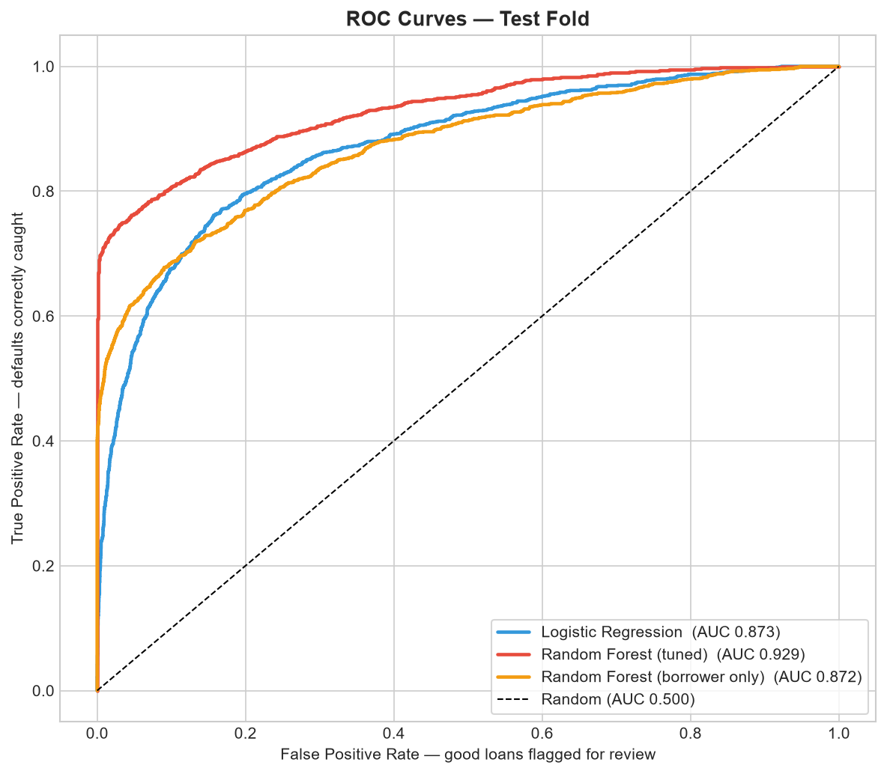
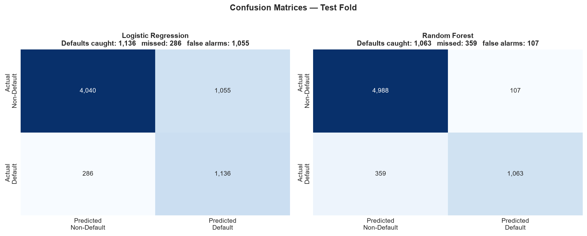
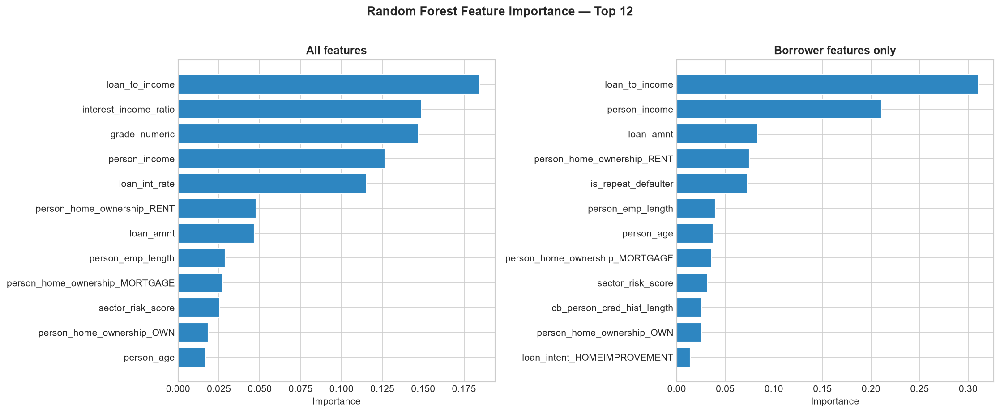

# Credit Scoring Model for Private Debt

Default risk scoring for SME lending, built and framed for a private debt investment committee rather than a
modelling competition.

## The business problem

Private debt funds in Ghana and across West Africa deploy capital into SMEs that formal banks price out or
turn away. The credit decision usually rests on a spreadsheet, a site visit and the judgement of whoever is
in the room. That judgement is often good, and it is documented properly, in credit papers and investment
memoranda that sit on file. What it is not is comparable. Two analysts assessing two deals weight the same
risks differently, and nothing in the file makes those weightings explicit enough to line up side by side.

Funds in this segment assess opportunities across sectors such as agribusiness, healthcare, renewable energy
and infrastructure, at target returns in the low to mid teens. A scoring layer does not replace the site
visit. It makes every file comparable on the same axis, and it tells the committee which files deserve the
extra hour of scrutiny.

This project builds that layer end to end, from raw loan data to a score band with a recommended action.

## The data

Kaggle Credit Risk Dataset (`laotse/credit-risk-dataset`). 32,581 loans, 12 columns, with a binary default
label. The full CSV is committed to `notebooks/` so every result here is reproducible.

It carries loan amounts, borrowing intent, lender-assigned loan grade, interest rate, income, employment
length and prior default history. Intent stands in as a sector proxy, which is the closest available analogue
to the way a private debt fund splits its own book.

It is a consumer lending dataset, not an SME book, and the limitations section below is honest about what
that costs.

| Check | Finding |
|---|---|
| Rows and columns | 32,581 loans, 12 columns |
| Class balance | 78.2% non-default (25,473), 21.8% default (7,108). Imbalance ratio 3.6 to 1 |
| Missing values | `loan_int_rate` 9.56%, `person_emp_length` 2.75% |
| Data quality flags | Impossible values in `person_age` (max 144) and `person_emp_length` (max 123) |
| Highest risk intent | Debt consolidation, 28.6% default across 5,212 loans |
| Lowest risk intent | Venture, 14.8% default across 5,719 loans |

## Methodology

**Cleaning.** Outliers capped rather than dropped, at 75 years of age, 40 years of employment and the 99th
percentile of income. Capping keeps the loan record and removes the distortion. In a real fund these values
would trigger a borrower file review before any credit decision, not a deletion.

**Imputation.** `loan_int_rate` filled with the median for its loan grade, since grade determines the rate
band directly. `person_emp_length` filled with the overall median.

**Derived features.** Loan-to-income ratio, sector risk tier, numeric credit grade, a repeat defaulter flag
and an interest burden ratio. The point of these is that they are the quantities a credit analyst already
reasons about, rather than whatever the raw columns happened to be.

**Two things we corrected before training.** Both are documented in `notebooks/model_cs.ipynb`.

The engineered loan-to-income ratio duplicated a column the dataset already provided. Two near-identical
features split the importance score between them, so we kept one.

More seriously, the sector risk tier had been built from default rates measured across the whole dataset,
including rows destined for the test set. That is target leakage, and it inflates every metric computed
against it. We rebuilt the tier using training-fold default rates only, and applied that mapping to both
folds. The general rule we now follow: nothing derived from the target is computed before the split.

**Training.** Stratified 80/20 split, seed 42, giving 26,064 training rows and 6,517 test rows, both carrying
a 21.82% default rate. Logistic regression as an interpretable baseline, then a random forest. Class
imbalance handled with balanced class weighting rather than SMOTE, so every training row remains a real loan
file a committee could ask to see. Tuning by grid search with three-fold cross validation, scored on recall
for the default class.

**Why recall and not accuracy.** 21.8 per cent of these loans default, so a model that predicts "no default"
for everyone is 78.2 per cent accurate and completely useless. For a fund, a missed default costs principal.
A false alarm costs an analyst an hour. We optimise for the expensive error.

## Results

| Model | Accuracy | Precision | Recall | F1 | AUC-ROC |
|---|---|---|---|---|---|
| Logistic regression | 0.7942 | 0.5185 | 0.7989 | 0.6288 | 0.8727 |
| Random forest | 0.9285 | 0.9085 | 0.7475 | 0.8202 | 0.9311 |
| Random forest, tuned | 0.9132 | 0.8297 | 0.7574 | 0.7919 | 0.9293 |
| Random forest, borrower features only | 0.8532 | 0.6568 | 0.6850 | 0.6706 | 0.8723 |

Best grid search parameters were `max_depth=None` and `min_samples_leaf=10`, at a cross-validated recall of
0.7650.

Two results here deserve to be stated rather than buried. Tuning raised recall from 0.7475 to 0.7574 and
lowered AUC slightly, from 0.9311 to 0.9293. That is the trade we asked for, since we tuned on recall, and it
is worth saying so plainly. The logistic regression has the highest recall of any model at 0.7989, but its
precision is 0.5185, so roughly half the loans it flags are false alarms. For a small team that volume of
review may not be affordable, which is why the tuned forest is the model we would take forward.





### The comparison that matters

`loan_grade` and `loan_int_rate` are not borrower characteristics. They are the previous lender's verdict on
the borrower, already priced in. A model built on them predicts default well, but a good part of what it has
learned is simply that the last underwriter was worried.

So we trained the same model without them. The AUC falls from 0.9293 to 0.8723, a gap of 0.0570.

That gap is small, and it is the most useful number in this project. It means most of the predictive power
sits in the borrower's own profile rather than in the grade somebody else assigned. From a business
perspective that matters, because a fund originating its own deals has no inherited grade to lean on. A
scoring layer built on affordability, income and credit history alone would still do the large majority of
the work.



### What drives the score

The table below reads the borrower-only model, not the full one, because that is the version a fund writing
its own paper would actually run.

| Feature | Importance | What it means for a lending decision |
|---|---|---|
| `loan_to_income` | 0.311 | The share of income committed to the loan is the single strongest signal, carrying close to a third of the model's weight on its own. Affordability, not history, is what separates the book. |
| `person_income` | 0.210 | Income level matters independently of the ratio. Two borrowers at the same loan-to-income can have very different capacity to absorb a shock, and the model sees that. |
| `loan_amnt` | 0.084 | Ticket size adds signal beyond the ratio. At the same income, larger facilities carry more risk, which argues for tighter scrutiny thresholds by size. |
| `person_home_ownership_RENT` | 0.075 | Renting rather than owning or holding a mortgage is a meaningful risk marker. We read it as a proxy for balance sheet depth, not as a judgement about the borrower. |
| `is_repeat_defaulter` | 0.073 | Prior default on file matters, but it ranks below affordability. For a lender that screens on credit history first, that ordering is worth knowing. |

Taken together, loan-to-income and income carry over half the explanatory weight. In other words the model is
largely a formalised affordability test, which is close to what an experienced credit analyst does by
instinct. The value is not that it knows something new. The value is that it applies the same test to every
file, in the same way, and writes down why.

## The scorecard layer

Not yet built. The next step is `scorecard_cs.ipynb`, which converts the tuned model's predicted
probabilities into score bands mapped to Low, Medium and High risk tiers, each with a recommended action of
approve, review or decline, and reports the observed default rate within each band. A probability is not a
decision. The band is the output a committee actually uses.

## What this means for private debt in Ghana

A layer like this sits between origination and the investment committee, not in place of either. It decides
nothing. What it does is give every file a comparable number and a stated reason, so the committee can spend
its hour on the three deals that need it rather than reading nine at the same depth. For a fund of this kind
the visible effect would be turnaround time and consistency, not better credit calls on its own. It is worth
noting that the honest claim here is narrower than it first sounds. The model ranks risk within a book. The
site visit still decides whether the business is real.

## Limitations

This is a consumer lending dataset, not an SME book, and the differences are not cosmetic. It carries no
sector classification of the kind a private debt fund uses, no geography, no currency exposure, and no repayment history
over time. It is a single cross-section, so it cannot see a borrower deteriorating.

The borrower-only model also loses real accuracy, falling to 0.8532 from 0.9132, with precision dropping to
0.6568. That is the cost of refusing to lean on another lender's grade, and a fund would need to decide
whether the extra review volume is worth it.

Before trusting a model like this on a live deal we would need repayment behaviour across periods,
sector and country fields, and some treatment of currency risk on locally denominated loans. The methodology
here transfers. The specific coefficients do not.

## Repository contents

```
notebooks/
  credit_risk_dataset.csv          source data
  eda_cs.ipynb                     exploratory analysis
  feature_engineering_cs.ipynb     cleaning, imputation, derived features
  model_cs.ipynb                   training, evaluation, model comparison
  model_results.csv                the results table above
  scorecard_cs.ipynb               score bands and actions (not yet built)
plots/                             all charts
requirements.txt
```

## Running it

```bash
python -m venv .venv && source .venv/bin/activate
pip install -r requirements.txt
cd notebooks
jupyter notebook
```

Run `feature_engineering_cs.ipynb` before `model_cs.ipynb`. The first writes the dataset the second reads.

---

Built by Patrick Rich Teye. Data and research analyst, private credit and energy analytics, Ghana.

**This is a personal project.** It is built entirely on a public dataset. It uses no proprietary, client or
employer data, and it does not represent the methods, views or policies of any organisation I have worked
for. Any resemblance to a real credit process is generic to the asset class.
